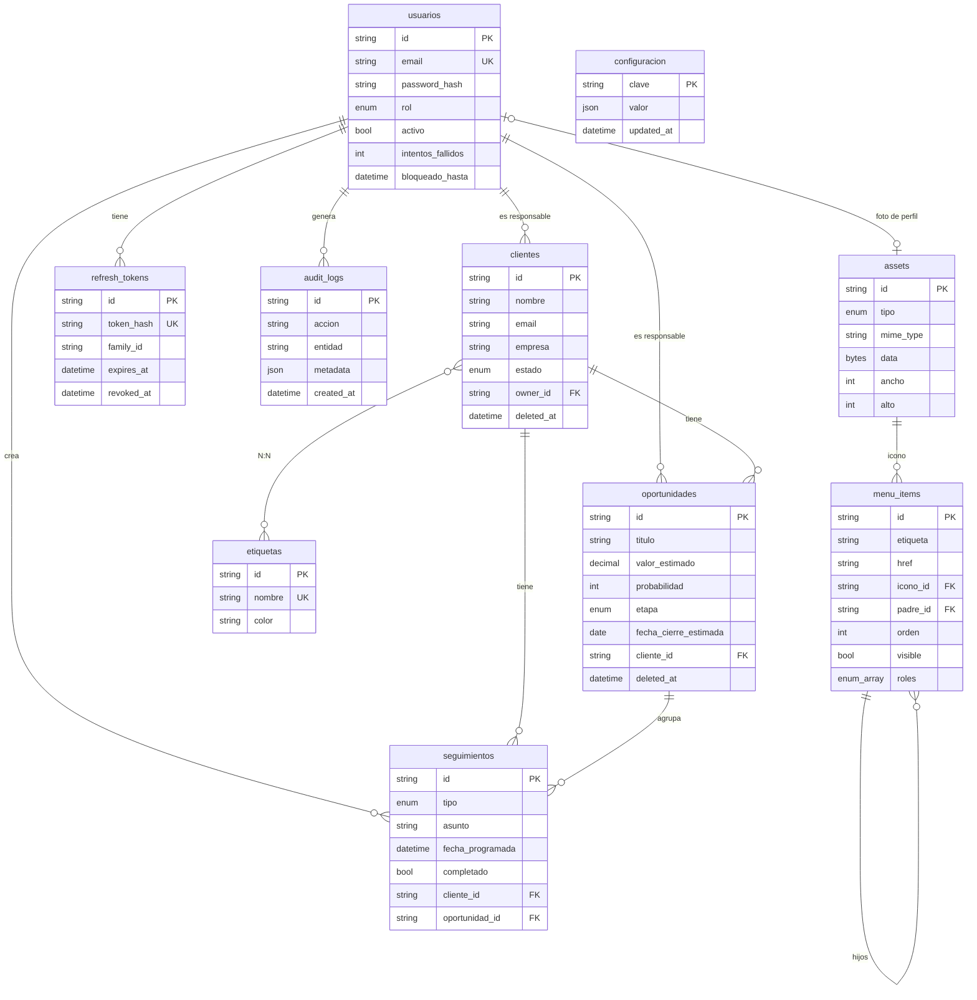

# Arquitectura

## Visión general

```mermaid
flowchart LR
  B[Navegador] -- HTTPS + cookies httpOnly --> P[proxy.ts<br/>auth, CORS, CSRF]
  P --> SC[Server Components<br/>app/(dashboard)]
  P --> API[Route Handlers<br/>app/api]
  SC --> S[Servicios<br/>lib/services]
  API --> S
  S --> PR[(Prisma ORM)]
  PR --> DB[(PostgreSQL<br/>Railway)]
  API --> G[Gemini API]
```

| Capa | Ubicación | Responsabilidad |
| --- | --- | --- |
| Proxy | `proxy.ts` | Verifica el JWT antes de cada página/endpoint, CORS, rechazo de escrituras de otros orígenes, renovación de sesión |
| UI | `app/`, `components/` | Server Components para lectura; Client Components solo para interacción (formularios, tablas, Kanban) |
| API | `app/api/**/route.ts` | Validación con Zod, autorización por rol (`withAuth`), respuestas JSON |
| Servicios | `lib/services/` | Reglas de negocio y alcance de datos por rol; compartidos por API y páginas |
| Datos | `prisma/` | Esquema, migraciones versionadas y seed |

## Modelo de datos



- Cascadas: eliminar un cliente (físicamente) elimina sus oportunidades y seguimientos; eliminar una oportunidad deja sus seguimientos con `oportunidad_id = NULL`.
- Clientes y oportunidades usan **soft delete** (`deleted_at`) para conservar el histórico.
- Índices en campos de búsqueda y filtrado: `nombre`, `email`, `owner_id`, `etapa`, `deleted_at`, `(owner_id, completado)`.

## Personalización

- **Tema**: `configuracion.tema` guarda dos colores. `lib/theme.ts` calcula variantes (oscura, suave, texto legible encima y tinta para enlaces) garantizando contraste WCAG AA, y el layout raíz las inyecta como variables CSS (`--brand`, `--accent`…). Tailwind las consume como `brand`, `brand-ink`, `accent-fg`, etc., así que ningún componente usa colores fijos.
- **Iconos**: la aplicación no trae iconos. Cada lugar donde puede ir uno es una *ubicación* (`lib/icon-slots.ts`); si no tiene imagen asignada no se muestra nada y el diseño no cambia. Los iconos se dibujan en un marco de tamaño fijo con `object-contain`.
- **Recorte**: logos, iconos y fotos se encuadran en el navegador (zoom, proporción, vista previa) y se suben ya en su tamaño final; el servidor vuelve a validar formato y dimensiones.
- **Menú**: `menu_items` con dos niveles. Si la tabla está vacía se usa el menú por defecto de `lib/modules.ts`. Ocultar un elemento no concede ni quita permisos: el acceso sigue controlado por rol en el servidor.

## Roles

| Permiso | ADMIN | GERENTE | VENDEDOR |
| --- | :-: | :-: | :-: |
| Gestionar usuarios y roles | ✔ | | |
| Ver registros de todo el equipo | ✔ | ✔ | Solo propios |
| Reasignar responsable | ✔ | ✔ | |
| CRUD clientes/oportunidades/seguimientos | ✔ | ✔ | ✔ (propios) |

El alcance se aplica en la consulta (`ownerScope` en `lib/auth/rbac.ts`), por lo que un vendedor que pide un ID ajeno recibe 404 y no puede inferir su existencia.

## Seguridad

**Autenticación**
- Access token JWT (HS256, 15 min) con `iss`, `aud`, `exp` y tipo verificados; algoritmo fijado para evitar ataques `alg: none`.
- Refresh token opaco de 384 bits, guardado solo como hash SHA-256, con **rotación en cada uso** y **detección de reutilización**: si se presenta un token ya usado se revoca toda la familia de la sesión.
- Ambos tokens en cookies `httpOnly`, `Secure` (producción) y `SameSite`; el refresh solo viaja a `/api/auth`. Nunca se guardan tokens en `localStorage`.
- En cada petición a la API se consulta el usuario en BD: desactivar un usuario o cambiar su rol tiene efecto inmediato.

**Contraseñas y login**
- bcrypt con costo 12; política de complejidad.
- Mensaje genérico ante credenciales inválidas y comparación bcrypt incluso si el correo no existe (evita enumeración por tiempo).
- Bloqueo de cuenta tras 5 intentos fallidos (15 min) y límite de 10 intentos por IP+correo cada 15 min.

**Aplicación**
- Validación de toda entrada con Zod (tipos, longitudes, formatos, rangos).
- Prisma usa consultas parametrizadas (sin SQL dinámico).
- Protección CSRF: cookies `SameSite` + rechazo de escrituras con `Origin` no permitido; CORS solo para orígenes en `ALLOWED_ORIGINS`.
- Cabeceras: CSP, `X-Frame-Options: DENY`, HSTS, `nosniff`, `Referrer-Policy`, `Permissions-Policy`.
- Redirecciones post-login restringidas a rutas internas (sin open redirect).
- Errores internos registrados en servidor y respondidos de forma genérica.
- Bitácora `audit_logs` de logins, bloqueos, cambios de usuarios, CRUD y llamadas a Gemini.

**Gemini**
- API key solo en el servidor; los datos del cliente se delimitan en el prompt para que no se interpreten como instrucciones.
- Límite 60 req/min global y 10 req/min por usuario, timeout de 20 s y análisis local de respaldo.
- La respuesta se renderiza como texto con un intérprete Markdown mínimo, sin `dangerouslySetInnerHTML`.

## Estructura de carpetas

```
app/
  (auth)/login, register          páginas públicas
  (dashboard)/...                 páginas protegidas (layout con sidebar)
  api/...                         endpoints REST
components/
  forms/ tables/ dashboards/ ui/ AIAssistant/
hooks/                            useAuth, useFetch, useLocalStorage, useFormSubmit, useDebounce
lib/
  auth/                           jwt, tokens, cookies, session, rbac, password
  api/handler.ts                  withAuth, manejo de errores
  services/                       lógica de negocio por módulo
  gemini.ts kpis.ts validators.ts formatters.ts rate-limit.ts audit.ts
prisma/                           schema, migraciones, seed
tests/                            pruebas unitarias (Vitest)
proxy.ts                          protección de rutas
```
